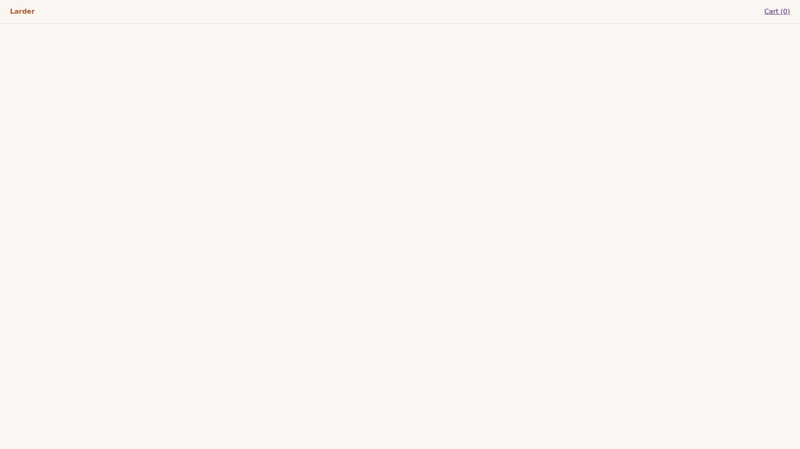
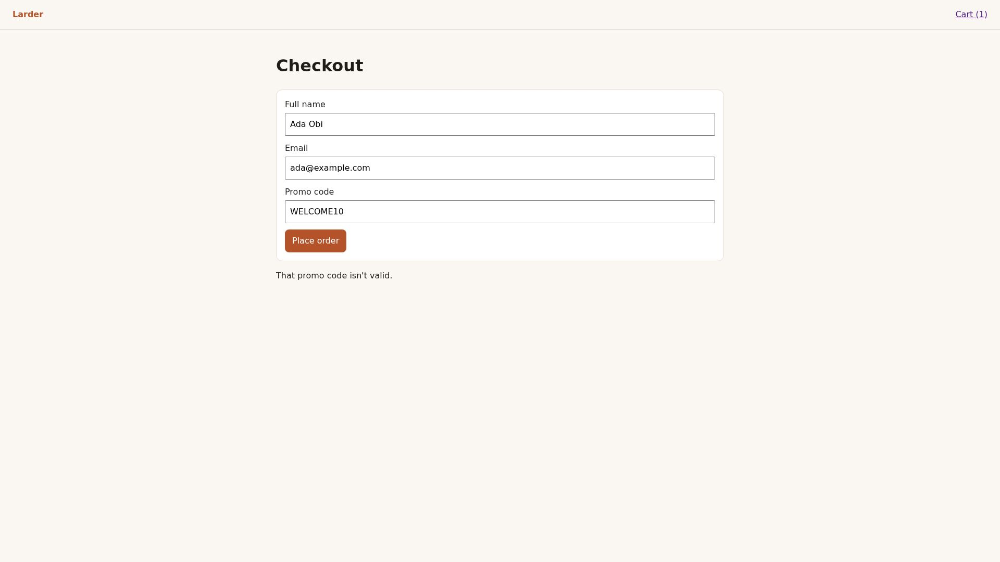

# Svels

**Delete the code your app doesn't need. Kane CLI proves your user journeys still pass after every cut, and a coding agent learns from every cut Kane rejects.**

AI coding agents only ever *add* code. A few weeks in, every vibe-coded app is full of old components, duplicate helpers, a v2 that was never wired in, and packages nobody imports. Nobody dares delete any of it, because code that *looks* unused can still be loaded at runtime. Svels deletes it for you, with proof: **nothing is removed unless Kane CLI walks your real user journeys in a real browser and they still pass.**

Built for the **Kane CLI Online Hackathon** (TestMu AI, 12–19 Nov 2026).

**See it work in about 20 seconds, no account needed:**

```bash
npx -y github:imprint-hash/svels demo
```

(A live scan of the bundled demo shop, then a replay of a real Kane run; the raw Kane NDJSON is in [`docs/evidence/`](docs/evidence/).) **Live report from that run:** https://imprint-hash.github.io/svels/sample-report.html

**In one minute:**
- **Ships:** `svels run` works end to end on real code nobody wrote for it. On AdminLTE (45k stars, 2,428 files) it cut 1,724 unused files (about 34 MB) in one trial while Kane confirmed four real pages still work; on a 40k-star repo it found a dead stylesheet Kane confirmed. On our demo shop it cut 15 files, 6 packages and 26 lines inside used files; every journey still passes.
- **Verified:** Kane CLI is the only judge of every cut. It caught 3 breaks a static dead-code scan would have shipped (a blank shop, a rejected promo code, a frozen cart badge), with Kane's own screenshots, triage and NDJSON in [`docs/evidence/`](docs/evidence/). On a real site of ours it caught a deletion that would have emptied a live dropdown.
- **Closed loop:** the coding agent edits code, Kane replays the journeys, and a failure goes back to the agent with Kane's triage and where the code is still used. Real transcript: attempt 1 removed `badgeText`, Kane failed "the header shows Cart (1)", attempt 2 kept it and removed the 4 truly dead helpers, Kane passed. What Kane proves needed is remembered for the next run.
- **Craft:** an agent that deletes code instead of adding it. Delta debugging keeps Kane runs small; Kane's cache makes re-runs free (34 of 34 runs replayed, 0 credits); files a green test can't vouch for (images, runtime-built paths) are never auto-deleted.

## The four criteria, with the evidence

**Ships.** One command (`svels run`) on a real app: scan → Kane baseline → batched cuts → agent edits → final Kane check → report. On **real code nobody wrote for it**: **AdminLTE (45k stars, 2,428 files), where it cut 1,724 unused plugin files in one trial while Kane confirmed four plugin-driven journeys still work**, plus a 40k-star GitHub repo, a clean template and two of our own earlier apps ([results](#tested-on-real-code-not-just-our-demo)). On the demo shop it removed **15 files (123 lines), 6 packages and 26 lines inside 3 used files**, and every journey still passes.

**Verified.** Kane caught three breaks that a static "dead code" scan would have shipped. Screenshots are from Kane's own browser at the moment it failed the cut; the raw NDJSON is in [`docs/evidence/`](docs/evidence/).

| What Svels tried | What Kane saw | Kane's own triage |
|---|---|---|
| delete `src/themes/light.js` (loaded by a computed path) |  the shop renders no products | *"Missing theme module prevents product catalog from rendering"* |
| delete `src/promos/welcome10.js` (loaded by the code the shopper types) |  *"That promo code isn't valid."* | *"Recorded WELCOME10 promo code is no longer valid"* |
| agent removes `badgeText` from `format.js` (only used by an inline script in `index.html`) | the header stays on "Cart (0)" after adding honey | *"Wildflower honey shows as added, but the header still displays an empty cart"* |

**Closed loop.** The coding agent edits code, Kane verifies, and Kane's verdict goes back to the agent:

```
Agent edit src/lib/format.js (attempt 1): removes badgeText, percent, formatDate, pluralize, truncate
  Kane rejected it: journey "browse" failed at "the header shows "Cart (1)""
  (Kane's triage: Wildflower honey shows as added, but the header still displays an empty cart.)
  Sending that back to the agent, with every place the removed names are still used.
Agent edit src/lib/format.js (attempt 2): removes percent, formatDate, pluralize, truncate
  Kane passed every journey -> the edit stands
```

File cuts loop the same way: a batch Kane fails is split and retried, a file Kane proves needed is explained by the agent and **remembered** (`.svels/learned.json`), so the next run doesn't try it again.

**Craft.** A tool a developer can point at their own repo tonight: it **deletes** code where every other agent adds it. Batched cutting (delta debugging) keeps Kane runs proportional to what's actually needed, not to the size of the codebase, and Kane's cache does the rest: on a re-run, **all 34 Kane runs replayed from cache, 0 credits**. And it doesn't trust a green test blindly: files the browser loaded, or that live in folders the code builds paths into at runtime, are never auto-deleted even when Kane passes (a missing picture doesn't fail a text check).


## Tested on real code, not just our demo

Every row is a real Svels run with Kane CLI driving Chrome. Nothing here was written for Svels. (On AdminLTE the scanner checked all 70 pages and Kane walked 4 journeys; pages without a journey are covered by the scan only. Its `build/` sources and `package.json` were protected with `keep` and `"packages": false`, since they serve the project's build, not the site.)

| Code | Looked unused | Cut (Kane-verified) | Kept: Kane caught a break | Guarded, not cut |
|---|---|---|---|---|
| **[AdminLTE v3](https://github.com/ColorlibHQ/AdminLTE/tree/v3)** (45k stars, 2,428 files, 70 pages) — the stress test | 1,724 | **1,724 files (603,861 lines, about 34 MB)** of plugin extras no page references: 536 flag images, 139 Moment.js locales, CodeMirror modes, Summernote and validation translations. All cut in **one trial**; Kane then walked the dashboard menu, a DataTables search, jQuery Validation and FullCalendar, and all four still worked | – | – |
| **[SB Admin 2](https://github.com/StartBootstrap/startbootstrap-sb-admin-2)** (9.8k stars, 1,878 files) | 1,659 | **1,659 files (123,821 lines)**, almost all of them Font Awesome's 1,646 spare icon files plus spare copies of jQuery, DataTables, Chart.js and Bootstrap. One trial; Kane then opened the sidebar's Components menu and searched the DataTables table ("Tiger"), and both still worked | – | – |
| **[bradtraversy/50projects50days](https://github.com/bradtraversy/50projects50days)** (40k stars, 52 apps, 167 files) | **1** | 1: `event-keycodes/dark-style.css`, referenced nowhere. Kane pressed "a" and still saw key code 65 | – | – |
| **[StartBootstrap Agency](https://github.com/StartBootstrap/startbootstrap-agency)** (built site, 25 files) | **0** | – | – | – |
| **Aisle**, a live hackathon site (ours, built before Svels) | 3 (first scanner version; it now reads paths in JavaScript strings, so today it flags only 1) | 1: `img/kite.svg`, an image the site stopped using | **1: `data/campaign.json`.** The page fetches it by URL; without it Kane saw the task dropdown lose "Lagos, Nigeria" | – |
| **Parasol**, a 90-file web app (ours, built before Svels) | 42 | 1: an unused icon | – | **41.** Kane passed with all 41 removed (a missing picture doesn't fail a text check), but the app builds paths into `demo/`, `products/`, `scenes/` at runtime, so Svels refused |

What the real runs taught Svels (each is now in the scanner, with a test): a version tag on a URL (`argon-dashboard.min.js?v=2.1.0`) still names the file, build scripts (`gulpfile.js`) are tooling, images shown in a README count as used (deleting them breaks the project's GitHub page, which Kane can't see), every HTML page is an entry point, `srcset` and `<meta content>` count as use, file paths written as strings in JavaScript count as use, and **folders the code builds paths into at runtime are guarded**: Kane can prove a file is needed, but never that it's safe to delete.

## Judges, start here

```bash
npx -y github:imprint-hash/svels demo   # 20 seconds, nothing to install, no account

# the full loop on your machine:
git clone https://github.com/imprint-hash/svels && cd svels
npm install                       # installs Kane CLI (@testmuai/kane-cli)
npx kane-cli login                # your TestMu account
npm test                          # 33 tests: scanner, Kane NDJSON parsing on real captured output, safety rules, agent loop
npm run scan                      # what looks unused in the demo shop (no Kane, instant)
SVELS_CHROME=$(which google-chrome) GROQ_API_KEY=... npm run demo   # the full loop -> examples/bloated-shop/.svels/report.html
```

Kane recordings belong to the account that made them, so on your account Svels has Kane learn the three demo journeys fresh on the first run (about 65 Kane credits, once); every trial after that replays from Kane's cache for free. The agent needs a free Groq or Gemini key. No time to run it? Open the **live report from our run: https://imprint-hash.github.io/svels/sample-report.html** (also in [`docs/sample-report.html`](docs/sample-report.html)).

The demo shop (`examples/bloated-shop`) at a glance:

| | |
|---|---|
| Candidates the import scan thinks are unused | **25** (19 files, 6 packages) + 9 unused exports inside 3 used files |
| Cut, with every journey still passing | **15 files (123 lines), 6 packages** (lodash, moment, axios, jquery, uuid, classnames), **8 exports (26 lines)** |
| Kept, because Kane caught a break | **2 files** (`light.js`, `welcome10.js`) and **1 export** (`badgeText`) |
| Not cut, left for you to review | **2**: `themes/dark.js`, `promos/blackfriday.js` (Kane passed, but the code builds paths into those folders at runtime) |
| Kane runs | 34 per full run, **all replayed from cache once recorded (0 credits)** |

## How it works

```
svels run
  1. scan       import graph from your entry points -> files and packages nothing imports
  2. baseline   Kane walks your journeys (svels/journeys/*_test.md) on the untouched app;
                Svels records every file the browser loads -> the journey map
  3. cut        remove a whole batch -> Kane replays every journey
                  pass -> keep the cut            fail -> split the batch in half, try again
                guarded files (loaded during a journey, or in a folder the code builds paths
                into at runtime) are tested too, but a pass only puts them on a review list
  4. agent      inside files the app uses, the coding agent removes exports nothing imports;
                Kane replays the journeys; a failure goes back to the agent with Kane's triage
                and every place the removed names still appear; up to 3 attempts
  5. explain    each file Kane proved needed: the agent says why, and it is remembered
  6. confirm    every accepted cut and edit applied together -> Kane walks every journey again
  7. report     .svels/report.html: numbers, journey map, kept files with reasons, every trial
     --apply    writes the proven cuts to your project
```

**The closed loop:** Svels cuts or the agent edits → Kane verifies in a real browser → Kane's NDJSON verdict decides keep or undo → failures go back to the agent with Kane's triage and where the code is still used → the agent retries; what Kane proved needed is remembered for the next run.

### How Svels uses Kane CLI

- **Plain-English journeys** as `*_test.md` files (`kane-cli testmd run`). You write *"Add rice, type WELCOME10, place the order, verify it charged $6.08"*, not selectors.
- **Kane's cache is what makes this affordable.** The first run authors each journey; every trial after that **replays the recording for free**. A full run on the demo costs credits only once.
- **`--no-adaptive-heal` on every trial.** If a cut breaks the page, the replay must fail, not quietly re-learn the step around the damage. The baseline run allows heal; trials never do.
- **`--agent` NDJSON** is parsed for the verdict, the failing step and credits used; every run's raw NDJSON is kept in `.svels/kane-logs/`.
- **Svels owns the Chrome Kane drives** (`--cdp-endpoint`), so it can turn the browser cache off (a deleted file can never be served from cache and fake a pass) and record which files each journey loads.

### Batched cutting (delta debugging)

Testing one file at a time would need one Kane run per candidate. Svels removes a whole batch at once; only when Kane fails does it split the batch and try each half. The number of Kane runs grows with the number of files that are *actually needed*, not with the size of your codebase.

## Use it on your app

1. Add `svels.config.json`:
   ```json
   { "entries": ["index.html"], "aliases": { "@": "src" }, "port": 5180, "journeys": "svels/journeys", "keep": ["svels/"] }
   ```
2. Write 1–3 journeys in `svels/journeys/` (see `examples/bloated-shop/svels/journeys/`), starting at `http://127.0.0.1:<port>/`.
3. `svels scan` to preview, `svels run` for a dry run with a report, `svels run --apply` to write the proven cuts.

Environment: `SVELS_CHROME` (a Chrome binary), `GROQ_API_KEY` or `GEMINI_API_KEY` for the agent's explanations (both have free tiers; without a key Svels writes a plain fallback explanation).

## Trust model: what you have to trust, and what you can check yourself

| Claim | Check it yourself | What you still have to trust |
|---|---|---|
| A cut was safe | Svels never decides that itself: every keep-or-undo is Kane CLI's verdict. The raw NDJSON of every Kane run is written to `.svels/kane-logs/`, and the failures shown above are in [`docs/evidence/`](docs/evidence/) with Kane's own screenshots | That your journeys cover the flows you care about. Svels guarantees *those* journeys still pass, nothing more |
| Nothing changed behind your back | `svels run` is a dry run: it works on a temporary copy and writes only a report. `--apply` writes the proven cuts, and only if the final Kane check with every cut together passed; review them with `git diff` | Nothing: it's your working tree and your git history |
| The agent's edits are safe | An agent edit stands only if Kane replays every journey and passes; a failed edit is thrown away. The report lists every attempt and Kane's verdict | That a passing journey is enough for that file. Anything a journey can't vouch for (images, fonts, files in folders the code builds paths into at runtime) is never auto-deleted |
| Your code stays private | Svels reads and serves your app locally. The only code that leaves your machine is a file the agent is asked to edit, sent to the model you configure (Groq or Gemini) | That model provider. Leave both keys unset and Svels makes no agent edits at all |

## Honest limits

- **Svels is only as safe as your journeys.** It guarantees the journeys you wrote still pass; code used only by flows you didn't write a journey for can be cut. The report lists exactly which journeys covered which files.
- **It cuts whole files, whole packages and unused exports inside files**, and it serves static or prebuilt apps itself. Bundled dev servers (Vite, Next) are next.
- The demo app was written for this hackathon to show realistic AI leftovers, including the three traps above. The real-code table is the honest test.
- The agent is a free model (Groq gpt-oss-120b, Gemini fallback); on a bad day it can be over-cautious and keep dead code. It can never remove code Kane didn't pass.

## Built with

- **Coding agent:** Claude Code wrote Svels with me during the event (12–19 Nov 2026). The repository started on 17 Nov.
- **Verification:** Kane CLI 0.10.3 (TestMu AI).
- **In-product agent:** Groq (gpt-oss-120b), Gemini as a fallback, for edits inside files and explanations.
- No other runtime dependencies: Node 22 built-ins only.

MIT licence.
