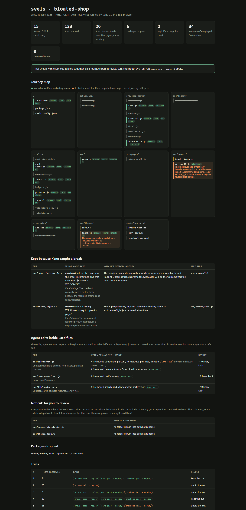

# Svels

**Delete the code your app doesn't need. Kane CLI proves your user journeys still pass after every cut.**

AI coding agents only ever *add* code. A few weeks in, every vibe-coded app is full of old components, duplicate helpers, a v2 that was never wired in, and packages nobody imports. Nobody dares delete any of it, because a file that *looks* unused can still be loaded at runtime.

Svels deletes it for you, and proves it was safe. It finds what looks unused, cuts it in batches, and after every cut **Kane CLI walks your real user journeys in a real browser**. A cut that keeps every journey green stays. A cut that breaks one is undone, and an agent reads Kane's failure and explains why that file is needed.

Built for the **Kane CLI Online Hackathon** (TestMu AI, 12–19 Nov 2026).



## Judges, start here

```bash
git clone https://github.com/imprint-hash/svels && cd svels
npm install                       # installs Kane CLI (@testmuai/kane-cli)
npx kane-cli login                # your TestMu account
npm run scan                      # what looks unused in the demo shop (no Kane, instant)
SVELS_CHROME=$(which google-chrome) npm run demo   # the full loop, writes examples/bloated-shop/.svels/report.html
```

The repo ships Kane's recordings of the three demo journeys, but recordings belong to the account that made them, so on your account Svels has Kane learn them fresh on the first run (about 65 Kane credits, once). Every trial after that replays from Kane's cache for free. No account handy? Open [`docs/sample-report.html`](docs/sample-report.html) for the report from our run.

What you'll see on the demo shop (`examples/bloated-shop`, a small store built quickly with an AI agent):

| | |
|---|---|
| Candidates the import scan thinks are unused | **25** (19 files, 6 packages) |
| Cut, with every journey still passing | **15 files (123 lines) and 6 packages** (lodash, moment, axios, jquery, uuid, classnames) |
| Kept, because **Kane caught a break** | **2**: `src/themes/light.js` (browse broke) and `src/promos/welcome10.js` (checkout broke) |
| Not cut, left for you to review | **2**: `themes/dark.js` and `promos/blackfriday.js`. Kane passed without them, but the code builds paths into those folders at runtime, so a user could still pick dark mode or type that code |
| Trials needed | **8**, thanks to batched cutting |
| Kane runs | 24 per full run; once the journeys are recorded, **all 24 replay from Kane's cache: 0 credits** |

The two saves are the point. Both files are loaded by a computed path (`import(\`../themes/${name}.js\`)`, `import(\`../promos/${code}.js\`)`), so every static "dead code" tool would delete them. Kane catches it in the browser, the cut is undone, and the agent writes down why:

> *"The checkout flow dynamically imports promos by name, so welcome10.js is required at runtime via a computed import path."*

## Tested on real code, not just our demo

Every row is a real Svels run with Kane CLI driving Chrome. Nothing here was written for Svels.

| Code | Looked unused | Cut (Kane-verified) | Kept: Kane caught a break | Guarded, not cut |
|---|---|---|---|---|
| **Aisle**, a live hackathon site (ours, built before Svels) | 3 (first scanner version; it now reads paths in JavaScript strings, so today it flags only 1) | 1: `img/kite.svg`, an image the site stopped using | **1: `data/campaign.json`.** The page fetches it by URL; without it Kane saw the task dropdown lose "Lagos, Nigeria" | – |
| **Parasol**, a 90-file web app (ours, built before Svels) | 42 | 1: an unused icon | – | **41.** Kane passed with all 41 removed (a missing picture doesn't fail a text check), but the app builds paths into `demo/`, `products/`, `scenes/` at runtime, so Svels refused |
| **[bradtraversy/50projects50days](https://github.com/bradtraversy/50projects50days)** (40k stars, 52 apps, 167 files) | **1** | 1: `event-keycodes/dark-style.css`, referenced nowhere. Kane pressed "a" and still saw key code 65 | – | – |
| **[StartBootstrap Agency](https://github.com/StartBootstrap/startbootstrap-agency)** (built site, 25 files) | **0** | – | – | – |

What the real runs taught Svels (each is now in the scanner): every HTML page is an entry point, `srcset` and `<meta content>` count as use, file paths written as strings in JavaScript count as use, and **folders the code builds paths into at runtime are guarded**: Kane can prove a file is needed, but never that it's safe to delete.

## How it works

```
svels run
  1. scan       import graph from your entry points -> files and packages nothing imports
  2. baseline   Kane walks your journeys (svels/journeys/*_test.md) on the untouched app;
                Svels records every file the browser loads -> the journey map
  3. cut        remove a whole batch -> Kane replays every journey
                  pass -> keep the cut            fail -> split the batch in half, try again
                guarded files (loaded during a journey, or in a folder the code builds paths
                into at runtime) are tested too, but a pass only puts them on a review list
  4. explain    each cut Kane failed goes to an agent with the file, Kane's failure and
                the runtime evidence -> one sentence on why it's needed + a keep rule
  5. confirm    every accepted cut applied together -> Kane walks every journey again
  6. report     .svels/report.html: numbers, journey map, kept files with reasons, every trial
     --apply    writes the proven cuts to your project
```

**The closed loop:** Svels cuts → Kane verifies in a real browser → Kane's NDJSON verdict decides keep or undo → failures go to the agent → the agent's keep rule feeds the next run.

### How Svels uses Kane CLI

- **Plain-English journeys** as `*_test.md` files (`kane-cli testmd run`). You write *"Add rice, type WELCOME10, place the order, verify it charged $6.08"*, not selectors.
- **Kane's cache is what makes this affordable.** The first run authors each journey; every trial after that **replays the recording for free**. A full run on the demo costs credits only once.
- **`--no-adaptive-heal` on every trial.** If a cut breaks the page, the replay must fail, not quietly re-learn the step around the damage. The baseline run allows heal; trials never do.
- **`--agent` NDJSON** is parsed for the verdict, the failing step and credits used; every run's raw NDJSON is kept in `.svels/kane-logs/`.
- **Svels owns the Chrome Kane drives** (`--cdp-endpoint`), so it can turn the browser cache off (a deleted file can never be served from cache and fake a pass) and record which files each journey loads.

### Batched cutting (delta debugging)

Testing one file at a time would need one Kane run per candidate. Svels removes a whole batch at once; only when Kane fails does it split the batch and try each half. The number of Kane runs grows with the number of files that are *actually needed*, not with the size of your codebase.

## Use it on your app

1. Add `svels.config.json`:
   ```json
   { "entries": ["index.html"], "aliases": { "@": "src" }, "port": 5180, "journeys": "svels/journeys", "keep": ["svels/"] }
   ```
2. Write 1–3 journeys in `svels/journeys/` (see `examples/bloated-shop/svels/journeys/`), starting at `http://127.0.0.1:<port>/`.
3. `svels scan` to preview, `svels run` for a dry run with a report, `svels run --apply` to write the proven cuts.

Environment: `SVELS_CHROME` (a Chrome binary), `GROQ_API_KEY` or `GEMINI_API_KEY` for the agent's explanations (both have free tiers; without a key Svels writes a plain fallback explanation).

## Honest limits

- **Svels is only as safe as your journeys.** It guarantees the journeys you wrote still pass; code used only by flows you didn't write a journey for can be cut. The report lists exactly which journeys covered which files.
- **Today it cuts whole files and whole packages**, and it serves static or prebuilt apps itself. Bundled dev servers (Vite, Next) and function-level cuts are next.
- The demo app was written for this hackathon to show realistic AI leftovers, including the two dynamic-import traps.

## Built with

- **Coding agent:** Claude Code wrote Svels with me during the event (12–19 Nov 2026). The repository started on 17 Nov.
- **Verification:** Kane CLI 0.10.3 (TestMu AI).
- **Agent explanations:** Groq (gpt-oss-120b), Gemini as a fallback.
- No other runtime dependencies: Node 22 built-ins only.

MIT licence.
